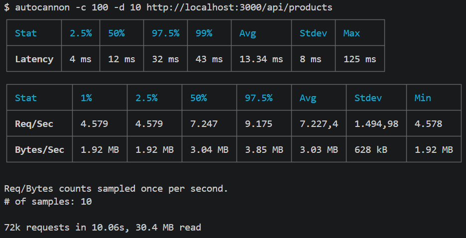

**Laporan Analisis Pengujian Performa (Benchmark) REST API**

1. Lingkungan Pengujian
Arsitektur Server: Node.js dengan Express.js (Stateless REST API)

Tools Pengujian: Autocannon

Parameter Uji: 100 koneksi bersamaan (concurrent connections) selama 10 detik (autocannon -c 100 -d 10 http://localhost:3000/api/products).

2. Hasil Analisis Performa
Berdasarkan pengujian beban (load testing) yang telah dilakukan menggunakan Autocannon, didapatkan metrik performa server sebagai berikut:

A. Latency (Waktu Respons)
Rata-rata (Avg): 13.34 ms

Maksimal (Max): 125 ms

Analisis: Latency mengukur jeda waktu yang dibutuhkan server untuk merespons sebuah request. Rata-rata waktu respons sebesar 13.34 milidetik menunjukkan bahwa server berjalan dengan sangat ringan dan responsif. Bahkan pada batas tertingginya (125 ms), server tetap mampu memberikan balasan yang sangat cepat dan tidak mengalami delay yang berarti (di bawah 1 detik) meskipun sedang digempur 100 koneksi secara bersamaan.

B. Throughput (Kapasitas Pemrosesan)
Request per Second (Req/Sec): Rata-rata 7.227,4 request/detik

Bytes per Second (Bytes/Sec): Rata-rata 3.03 MB/detik

Analisis: Throughput mengukur berapa banyak request yang berhasil diproses dan diselesaikan dalam periode tertentu. Hasil pengujian menunjukkan bahwa server mampu menangani beban trafik sebesar rata-rata 7.227,4 permintaan per detik secara stabil, dengan kecepatan transfer data mencapai 3.03 MB per detik. Hal ini membuktikan bahwa server memiliki kapasitas pemrosesan yang sangat baik dalam menghadapi lonjakan trafik.

3. Kesimpulan
Implementasi backend service berbasis REST API yang bersifat stateless menggunakan Node.js ini terbukti sangat efisien. Karena server tidak perlu menyimpan data session state klien di memori, ditambah dengan sifat non-blocking I/O bawaan Node.js, aplikasi ini mampu menghasilkan performa yang optimal (kapasitas throughput yang tinggi dengan latency yang sangat rendah) saat berada di bawah beban trafik secara bersamaan.